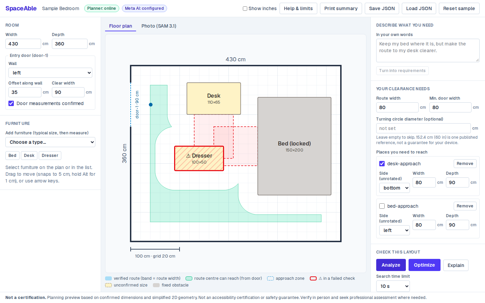
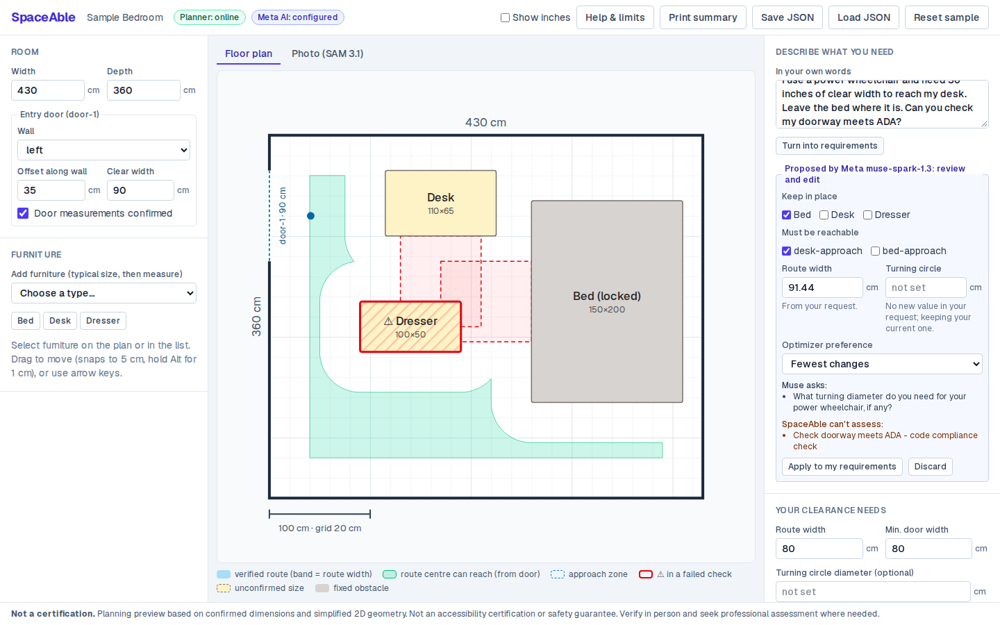
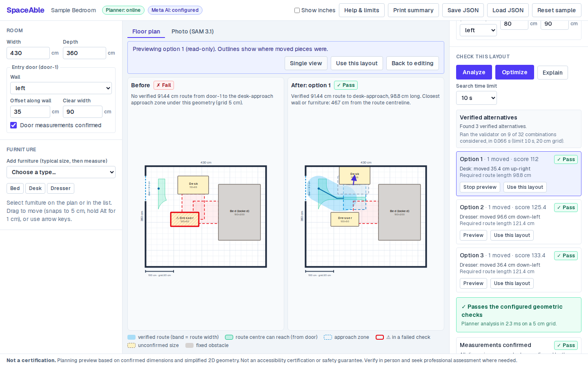
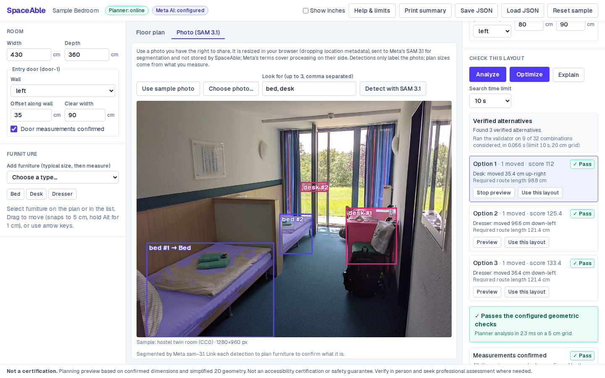

# SpaceAble

**Measured, verified furniture rearrangements for people who use a wheelchair or another mobility
device.** You enter your room and the clearance you need. Meta's models help you describe the
problem. A geometry engine, not an AI, decides whether a layout works.

> Planning preview based on confirmed dimensions and simplified 2D geometry. Not an
> accessibility certification or safety guarantee. Verify in person and seek
> professional assessment where needed.



## What it does

1. **Checks your room.** Furniture must fit inside the room without overlapping. The door must be wide enough.
   An 80 cm (or your own) route must exist from the door to each place you need to reach, plus an optional
   turning circle. Every result shows measured vs required values and the assumptions behind it.
2. **Finds rearrangements.** It searches discrete placements cheapest-first, moving at most three pieces.
   Each option is re-checked by the same validator before you see it. When no option exists, it says why,
   and never says "impossible" just because it ran out of time. It can also find a place for a piece you
   don't own yet ("would a 100 × 40 cm bookshelf fit?"), moving other furniture only if needed.
3. **Uses Meta's models where they help, and keeps them out of the verdict:**
   - **Muse Spark 1.3** turns *"I need 36 inches to reach my desk, leave the bed where it is"* into
     editable constraints you approve (91.44 cm, bed locked). Unknown furniture is rejected, and
     unstated measurements become questions. It also explains results, but a draft quoting any number
     the planner didn't produce is replaced by a labelled template.
   - **SAM 3.1** outlines furniture in a room photo (parsed with Meta's official `@meta-sam/parser`). You
     link what it finds to your plan. Photo pixels are never turned into measurements.
   - **Muse Voice Transcribe** lets you say your request instead of typing it, for anyone who finds
     typing hard. Tap **Speak**, then tap again to stop (no press-and-hold). The words land in the text
     box for you to check and edit, and nothing goes to Muse Spark until you ask.
   - **Ask about your room** is a Muse Spark assistant that answers questions such as *"Keep the dresser
     where it is too. I need 36 inches."* It runs the planner itself, using `check_layout` and
     `find_layouts` as tools, over up to three rounds, and a progress bar shows each step as it happens.
     Widths and furniture sizes must come from your own words; otherwise it asks. Every number in the
     answer is checked against the planner. Each check becomes a what-if you can load, preview and undo,
     and follow-up questions build on earlier results.

| Muse proposes, you approve | Before / after, both verified | SAM outlines, you confirm |
| --- | --- | --- |
|  |  |  |

## Run it locally

Requires Python 3.11+ (3.12 tested) and Node 20.17+ (24 tested).

```bash
# Terminal 1: planner API
cd services/planner
python -m venv .venv && source .venv/bin/activate   # or: uv venv --python 3.12 .venv
pip install -e '.[dev]'
uvicorn app.main:app --reload --port 8000

# Terminal 2: web app
cp .env.example apps/web/.env.local                   # add MODEL_API_KEY for the AI features
cd apps/web
npm install
npm run dev                                           # open http://localhost:3000 (not 127.0.0.1)
```

Without a Meta key, everything except the AI features works. The header shows whether the planner is
online and whether a key is configured, never the key itself. **Help & limits** in the app walks through
the workflow. Deployment: [`docs/deploy.md`](docs/deploy.md).

## How it decides

The person and device are modelled as a disc as wide as the route. Valid centre positions are the
room shrunk by that radius, minus every piece of furniture grown by it (the arcs are buffered so the
polygon always errs on the safe side). A grid A* search with no diagonal corner-cutting looks for a path
from just inside the door to the approach zone. Every segment is re-verified against the exact free
space, and the clearance is measured directly against the furniture rectangles. More detail, including
what is deliberately simplified, is in [`docs/architecture.md`](docs/architecture.md).

**Evidence:** [`docs/benchmark.md`](docs/benchmark.md) covers 21 synthetic rooms. Every reported layout was
re-analysed and independently re-checked: 0 mismatches, reproducible across runs. These are synthetic rooms
and say nothing about real homes.

## Tests

```bash
cd services/planner && pytest -q && ruff check .        # 72 tests: geometry, routes, optimizer, API, benchmark
cd services/planner && python -m app.benchmark --repeat --write ../../docs/benchmark.md
cd apps/web && npm run test && npm run lint && npm run typecheck   # 68 tests, Meta and the planner mocked at the fetch layer
cd apps/web && npx playwright install --with-deps chromium && npm run test:e2e   # 19 browser flows, AI routes mocked
cd apps/web && npm run smoke:meta -- path/to/consented-photo.jpg bed speech.wav   # REAL, billed Meta calls
```

## Layout

```text
apps/web/            Next.js 16 UI + API routes (planner proxy, Meta proxy; keys stay server-side)
services/planner/    FastAPI + Shapely geometry engine and optimizer (the only place pass/fail is decided)
shared/fixtures/     test rooms used by both sides, the tests and the benchmark
shared/schemas/      JSON Schema exported from the Pydantic models
docs/                architecture, benchmark, deployment, demo script, screenshots
```

## Limitations

- 2D, axis-aligned rectangles only. No heights, door swing, knee/toe clearance or wheelchair kinematics.
- Results are only as good as the measurements entered. Unconfirmed sizes block a verdict.
- "No route" means none was found on a 5 cm grid, not that none exists.
- Not an ADA or building-code check, and no substitute for an occupational therapist.
- Rate limits live in memory per server instance.

## Privacy and security

Rooms stay in your browser unless you export them. Photos are resized in the browser (which drops EXIF/GPS),
sent to Meta only when you press Detect, and not stored or logged by SpaceAble. Voice recordings are
converted to WAV in the browser, sent to Meta only when you stop recording, and not stored or logged
either; your furniture names go with them as recognition hints. Meta's terms govern
processing on their side. The Meta key and the planner's shared secret are server-only. The planner rejects
any caller without the secret.

## Attribution

- Built with Meta's Model API: **Muse Spark 1.3**, **SAM 3.1** and **Muse Voice Transcribe** (https://dev.meta.ai). SAM output is parsed
  with Meta's [`@meta-sam/parser`](https://www.npmjs.com/package/@meta-sam/parser) (SAM License).
- Sample photo `apps/web/public/samples/hostel-twin-room.jpg`: "Twin room in a German youth hostel with single
  beds and wardrobe A" by Profpcde,
  [Wikimedia Commons](https://commons.wikimedia.org/wiki/File:Twin_room_in_a_German_youth_hostel_with_single_beds_and_wardrobe_A.jpg),
  CC0 1.0 (1280 px copy).
- Reference dimensions mentioned in the UI (e.g. a 60 in / 152.4 cm turning circle) come from the U.S. Access
  Board guides. They are editable references, not compliance checks.

## License

MIT (see `LICENSE`). Third-party packages keep their own licenses.
